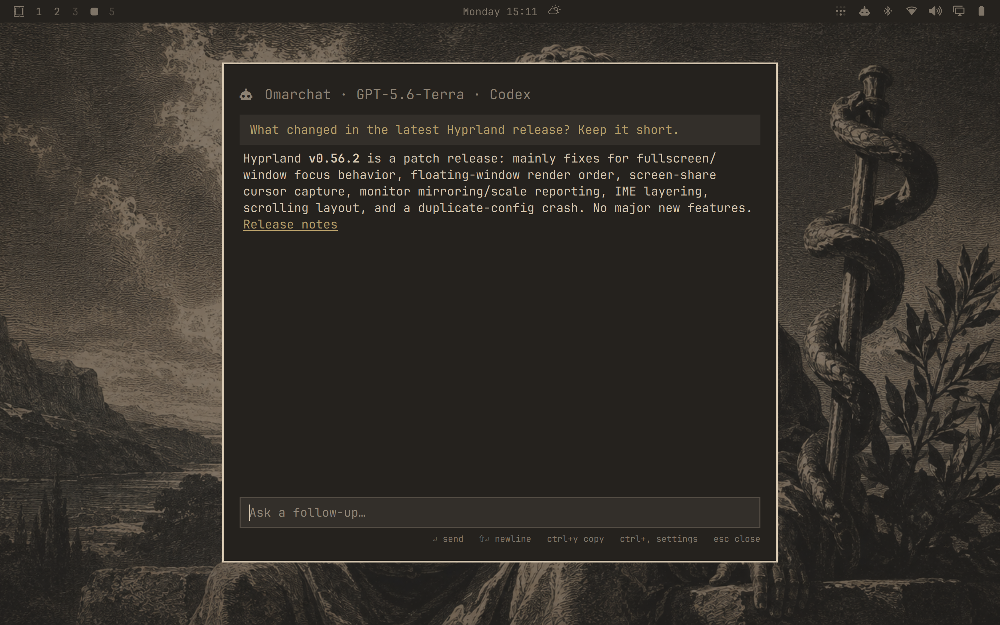

# Omarchat

A quick, throwaway AI chat for [Omarchy](https://omarchy.org). Press a shortcut,
ask a question, get an answer, and press Esc. The conversation is gone: nothing
is saved.



Omarchat opens as a card in the same style as the Omarchy menu and follows your
theme. It works with the coding agents you already use: pick any model they
offer, including local ones. The model can search the web and cite its sources,
but it **cannot** touch your system: no files, no commands, no local network
(see [Security](#security)).

## Requirements

- Omarchy 4 (the Quickshell-based `omarchy-shell`)
- At least one supported agent, installed and logged in:
  - [Claude Code](https://claude.com/claude-code): `omarchy default agent claude`,
    then run `claude` once and sign in.
  - [Pi](https://pi.dev): `omarchy default agent pi`, then sign in to providers
    with `/login` inside `pi`. Every model Pi can use shows up in Omarchat,
    including local servers such as llama.cpp and Ollama.
  - [Codex](https://developers.openai.com/codex): `omarchy default agent codex`,
    then `codex login`. Settings lists the models your plan offers.
  - [opencode](https://opencode.ai): `omarchy default agent opencode`, then
    `opencode auth login`. Its free Zen models aren't listed: they refuse to
    run with tools switched off.
- `bubblewrap`, for the sandbox: `omarchy pkg add bubblewrap`

No agent yet? Open Omarchat anyway. It lists the agents it works with and why
each isn't ready ("Not installed", "Not logged in"). Choose one and Omarchy
installs it if needed, makes it your default agent, and opens it so you can
sign in.

## Install

```bash
omarchy plugin add https://github.com/azaeldrm/omarchat.git --enable
```

Then bind a key in `~/.config/hypr/bindings.lua`. For example, to use
Super+Alt+Space (Omarchy binds it to "Apps menu" by default, so unbind that
first):

```lua
hl.unbind("SUPER + ALT + SPACE")
o.bind("SUPER + ALT + SPACE", "Omarchat", "omarchy-shell shell toggle azaeldrm.omarchat '{}'")
```

Hyprland reloads on save; `hyprctl configerrors` should print nothing.

### Optional: Alt+Space menu rows

`extras/omarchy-menu.jsonc` adds an **Omarchat** entry to the Omarchy menu with
**Ask Omarchat** and **Settings**. Paste its rows inside the braces of
`~/.config/omarchy/extensions/omarchy-menu.jsonc`.

## Usage

| Key | Action |
| --- | --- |
| Enter | Send |
| Shift+Enter | New line |
| Ctrl+, (or click the header) | Settings: choose the agent and model |
| Ctrl+Y | Copy the last answer as Markdown |
| PgUp / PgDn | Scroll |
| Esc, the shortcut again, or a click outside | Close and forget the chat |

Clicking a link opens it in your browser and closes the chat.

### Choosing a model

Settings lists every supported agent with the models it offers, by name.
Type to filter, use the arrow keys, and press Enter. An agent that can't be
used says why ("Not logged in", "isn't installed"). Before your first question
the choice applies right away; once a chat has started, it applies to the next
one.

Until you choose, Omarchat uses the first usable agent's default: Claude Haiku
5.5 through Claude Code, or Pi's own default model. It works out of the box
with whichever agent you've set up. Your choice is saved to
`~/.config/omarchy/omarchat/model`.

The lists refresh in the background every time the card opens, so an agent you
install or log in to shows up without any setup.

A few things to know about the lists:

- **Pi and opencode list their whole catalog** for every provider you're
  logged in to, and some plans don't include every model. For example, a
  ChatGPT-based Codex login refuses older models. When a model is refused like
  that, Omarchat greys
  it out in settings with the reason for a week, in case your plan changes.
- **Local servers list the models they have loaded** when the list refreshes,
  so loading a different model on your server changes the list. The first
  answer after a cold start can take a while.

From scripts, you can open the card with a question already asked, or straight
into settings:

```bash
omarchy-shell shell summon azaeldrm.omarchat '{"prompt":"What is the latest Hyprland release?"}'
omarchy-shell shell summon azaeldrm.omarchat '{"settings":true}'
```

## How it works

- `Omarchat.qml` is an overlay plugin. It isn't kept loaded, so hiding it
  destroys the instance, and with it the chat.
- `ChatView.qml` runs one `bin/omarchat-session` process for the life of the
  card. It starts as soon as the card opens, so the agent is warm by the time
  you finish typing.
- Each agent has a backend in `backends/` (see `backends/lib.sh`). It checks
  whether the agent is usable, lists its models, and runs a chat, translating
  the agent's own output into one event format the card understands.
  `bin/omarchat-models` collects the lists for settings and caches them in
  `~/.cache/omarchat/models.json`.

## Security

Omarchat is built so the model can search the web and do nothing else,
whichever agent answers:

- **Search is the only way out.** Claude Code gets its WebSearch, which runs
  on Anthropic's servers. Pi has no search of its own, so Omarchat gives it
  `web_search` (`backends/pi-web-search.ts`), which sends the query to
  [Exa](https://exa.ai)'s hosted search. Codex keeps its web search, which runs
  on OpenAI's side, and has every other tool switched off: shell, command
  execution, apps, browsers, computer use, plugins, skills, MCP servers, hooks,
  and image generation. opencode keeps its `websearch` (also Exa), with every
  other permission denied. None of these search tools takes a URL from your
  machine, so the model can't reach localhost or your network. Page-fetching
  tools are left out on purpose: they fetch from your machine, which would put
  localhost and LAN services in reach.
- **The agent runs in a bubblewrap sandbox.** `/` is read-only, `/tmp` is a
  private tmpfs, and `$HOME` is empty: only Omarchat and the agent's own
  program come back, read-only, plus the agent's state, writable so your login
  can refresh (`~/.claude` and `~/.claude.json`, `~/.pi/agent`, `~/.codex`,
  opencode's `auth.json`). Your documents, keys, and other configs aren't there
  to read, whatever tools an agent turns out to have. The sandbox dies with the
  card.
- **Nothing is persisted.** Sessions run without saving transcripts
  (`--no-session-persistence`, `--no-session`, ephemeral Codex threads, and a
  throwaway opencode database inside the sandbox).

Codex keeps a few tools no setting removes: `view_image` (reads images from
disk), `apply_patch` (edits files), code mode (`functions.exec`, scripts that
call its tools), subagents, and listing MCP resources. They're covered rather
than trusted: the empty `$HOME` leaves no personal images to view, edits and
writes can't land on a read-only filesystem, a subagent asked to run a command
created nothing in testing, and with no MCP servers configured there are no
resources to list.

Tested with all four agents by asking them to write a file, run a command,
read a local file, fetch `http://127.0.0.1` (directly and from a code-execution
tool), have a subagent run a command, and with a raw Pi RPC `bash` command
typed as the message. Nothing reached disk or the local test server, and the
canary file never showed up in an answer.

What you type and the answers go to the model's provider, and your search
queries go to Exa when using Pi or opencode. Usage counts against your plans.

Exa's keyless search is rate-limited in short bursts. Omarchat retries once and
then tells you; set `EXA_API_KEY` (free at exa.ai) in your session environment
for higher limits.

## Update and remove

```bash
omarchy plugin update azaeldrm.omarchat
omarchy plugin remove azaeldrm.omarchat
```

After an update, run `omarchy restart shell`. The shell keeps the previously
loaded QML until it restarts.

## Troubleshooting

- **The card names something missing** (an agent, bubblewrap): install it (see
  [Requirements](#requirements)).
- **An answer says to log in:** sign in to that agent (`claude`, or `/login`
  inside `pi`).
- **A model you expected isn't in settings:** the list refreshes every time the
  card opens. For a local server, check the model is loaded there.
- **Nothing opens:** check `omarchy plugin list` shows `omarchat` enabled, then
  look for errors with `quickshell log -p /usr/share/omarchy/shell -t 50`.

## Development

```bash
tests/run           # offline: no network, no logins (what CI runs)
tests/run --live    # also real chats with each logged-in agent
tests/run sandbox   # just the named suites
```

The offline suites need bash, jq, bubblewrap, and shellcheck. They check the
manifest the way `omarchy plugin validate` does, lint every script, replay
recorded agent sessions through each backend's translation
(`tests/fixtures/`), and test model selection and the sandbox with stand-in
backends. They make no model calls.

The live suites make a few cheap model calls. They chat with each agent
through the real sandbox, and run the attack tests that prove a session can
only search: write a file, run a command, read a local file, fetch a local
server (directly and from a code-execution tool), have a subagent run a
command, and type a raw Pi command as a message. They check what happened (no
files, no canary in answers, no local requests, only search tools), never the
model's wording. Choose models with `OMARCHAT_TEST_<AGENT>_MODEL`, e.g.
`OMARCHAT_TEST_PI_MODEL=openai/gpt-5.5`.

To add an agent, give it a backend in `backends/` (see `backends/lib.sh`),
record a session for `tests/fixtures/` with a scrub filter, and make sure
`tests/run --live` passes.

## License

MIT
